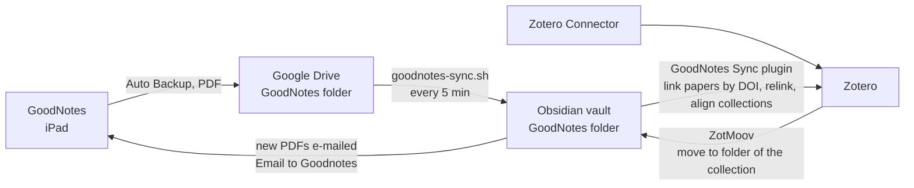

# GoodNotes ⇄ Obsidian ⇄ Zotero

Keep the same PDFs, in the same folders, in **GoodNotes** (where you read and handwrite),
**Obsidian** (where you take linked notes) and **Zotero** (where you manage references and cite).

Save a paper with Zotero Connector into a collection, and it shows up in the Obsidian folder
with the same name and in GoodNotes. Add a PDF in GoodNotes, and it shows up in Obsidian and,
if it is a paper, in Zotero. Annotate or move it in GoodNotes, and Obsidian and Zotero follow.

macOS only. Built from free tools plus a small shell script and a small Zotero plugin.

> Not affiliated with GoodNotes, Obsidian, Zotero or any plugin mentioned here.
> Test it on a few files first, and keep backups of your library.

## What you can do, and where

| Action | Do it in | Result |
|---|---|---|
| Import a paper | Zotero (Connector), GoodNotes, or Obsidian (inside the `GoodNotes` folder) | It appears in all three. In GoodNotes it lands in the root folder when it comes from Zotero or Obsidian. |
| Annotate | GoodNotes | Annotations show in Obsidian and Zotero |
| Move or rename | GoodNotes only | Follows in Obsidian (links in your notes are updated) and in Zotero (link and collection updated) |
| Delete | GoodNotes, then also on Google Drive | Disappears from Obsidian. Zotero keeps the item without the PDF. |
| Notes, maps, diagrams | Obsidian, outside the `GoodNotes` folder | Obsidian only |

Rules of thumb:
- Manage PDFs in GoodNotes. Treat the `GoodNotes` folder in Obsidian as read-only.
- Save new papers with Zotero Connector, choosing the collection that matches the GoodNotes folder.
- Do not rename PDFs in Obsidian or Zotero (do it in GoodNotes).
- GoodNotes Auto Backup does not delete remote files: after deleting a document in GoodNotes, delete it on Google Drive too.

## How it works



Pieces:

1. **GoodNotes Auto Backup** writes every document as a PDF to a Google Drive folder, keeping your folder structure. It is one-way and runs periodically (often only while GoodNotes is open).
2. **Google Drive for desktop** makes that folder available on the Mac.
3. **`sync/goodnotes-sync.sh`** (run by cron every 5 minutes):
   - copies new or changed PDFs from Drive to the `GoodNotes` folder of your Obsidian vault, at the same path;
   - detects moves and renames done in GoodNotes, updates the links in your notes and records them in `moves.tsv` for Zotero;
   - e-mails PDFs that were added to the vault folder (by hand or by Zotero) to your **Email to Goodnotes** address, so they get into GoodNotes;
   - when GoodNotes backs such a PDF up under a different name (`X.pdf (1).pdf`, `X.pdf.pdf`), keeps the GoodNotes copy and moves the original to the Trash;
   - moves to the Trash the PDFs that disappeared from Drive.
4. **Zotero** with:
   - **Better BibTeX** (citation keys, needed by Zotero Integration);
   - **ZotMoov**, set to *move* each new attachment into the vault folder named after its collection, as a linked file;
   - **GoodNotes Sync** (`zotero/`, this repo): every 5 minutes it links new papers found in the folder (by the DOI in their first two pages) to the right item and collection, applies moves/renames, and repairs broken links. PDFs without a DOI (lecture slides, notes) are skipped.
5. **Obsidian** with **Zotero Integration** (literature notes from Zotero) and **PDF++** (highlights as links to the exact passage). A note template is in `obsidian/`.

## Requirements

- A Mac that is on most of the time (the script and the plugin run there).
- GoodNotes on iPad, with Auto Backup (needs a Google Drive account here; other providers work with path changes).
- Google Drive for desktop.
- An Obsidian vault in iCloud Drive (any synced location works, with path changes).
- Apple Mail with an account that can send e-mail (used to send PDFs to GoodNotes).
- Zotero 7 or later (tested on Zotero 10), with Zotero Connector in your browser.

## Setup

### 1. GoodNotes → Google Drive

1. Install **Google Drive for desktop** on the Mac and sign in. Check that `~/Library/CloudStorage/GoogleDrive-<your account>/` exists.
2. In GoodNotes on iPad: **Settings → Cloud & Backup → Auto Backup** → on → Google Drive → sign in → folder `GoodNotes` → file format **PDF** (or *Goodnotes & PDF*).
3. In GoodNotes settings, find your **Email to Goodnotes** address. Keep it private.

### 2. The Obsidian vault

1. Create (or use) a vault in iCloud: `~/Library/Mobile Documents/iCloud~md~obsidian/Documents/<Vault>`.
2. Inside it, create a folder `GoodNotes` at the vault root. Do not put anything else in it.
3. Create the folders `Sources/` (one note per paper) and `Templates/`, and copy `obsidian/Zotero - Source.md` into `Templates/`. For a fuller note structure and a papers dashboard, see [`extras/`](extras/).
4. Community plugins: **Zotero Integration** and **PDF++**.

### 3. The sync script

```sh
mkdir -p ~/.goodnotes-sync
cp sync/goodnotes-sync.sh ~/.goodnotes-sync/
chmod +x ~/.goodnotes-sync/goodnotes-sync.sh
cp sync/config.example ~/.goodnotes-sync/config
open -e ~/.goodnotes-sync/config        # set the paths and your Email to Goodnotes address
```

Try it once by hand, without sending e-mails:

```sh
DRYRUN=1 ~/.goodnotes-sync/goodnotes-sync.sh && cat ~/.goodnotes-sync/state/log.txt
```

Then schedule it every 5 minutes:

```sh
(crontab -l 2>/dev/null; echo '*/5 * * * * /bin/sh "$HOME/.goodnotes-sync/goodnotes-sync.sh"') | crontab -
crontab -l      # check that the line is there exactly once
```

Give cron access to iCloud and Google Drive: **System Settings → Privacy & Security → Full Disk Access → +**, press **Cmd+Shift+G**, type `/usr/sbin/cron`, add it.
The first e-mail may trigger a macOS prompt asking to let the script control **Mail**: allow it.

### 4. Zotero

1. Install **Better BibTeX** (`.xpi` from its GitHub releases) and **ZotMoov** (`.xpi` from its GitHub releases): **Tools → Plugins → gear → Install Plugin From File…**.
2. Install **GoodNotes Sync**: `zotero/goodnotes-sync-1.1.0.xpi`, the same way. It reads the paths from `~/.goodnotes-sync/config`. (The `.xpi` is just a zip of `zotero/manifest.json` and `zotero/bootstrap.js`, the readable source.)
3. **ZotMoov** settings (Zotero → Settings → ZotMoov):
   - Directory to Move/Copy Files To: your vault's `GoodNotes` folder;
   - File Behavior: **Move**;
   - Automatically Move/Copy Files When Added: on;
   - Automatically Move/Copy Files to Subdirectory: on, Subdirectory String `{%c}`.
4. Create collections that mirror your GoodNotes folders: **Tools → Developer → Run JavaScript**, tick *Run as async function*, paste `zotero/create-collections-from-folders.js`, set `FOLDER`, run. (Later on, the plugin also creates missing collections by itself.)
5. Within a few minutes the plugin links the papers already in your GoodNotes folders to Zotero. Check `~/.goodnotes-sync/state/zotero-log.txt`.

### 5. Literature notes in Obsidian (optional)

In **Zotero Integration** settings: Note Import Location `Sources`, then **Add Import Format**:
- Name `Source`
- Output Path `Sources/{{citekey}}.md`
- Image Output Path `Sources/attachments/{{citekey}}/`
- Template File `Templates/Zotero - Source.md`
- Bibliography Style: the one you use (e.g. APA 7th)
- Also press **Download** next to *PDF Utility* (needed to import Zotero highlights).

With Zotero open, run **Cmd+P → Zotero Integration: Source** and pick a paper. Re-importing rewrites the note except the **My notes** section.

## Daily use

- **New paper from the web:** Zotero Connector → choose the collection. Within ~5 minutes it is in Obsidian and has been e-mailed to GoodNotes (root folder). In GoodNotes, move it into the matching folder: everything else follows.
- **New PDF in GoodNotes:** put it in the right folder. After the next Auto Backup it reaches Obsidian; if it is a paper, Zotero links it a few minutes later.
- **New PDF from Obsidian:** drop it into the matching subfolder of `GoodNotes`. It is e-mailed to GoodNotes and linked in Zotero if it is a paper.
- **Notes:** write them outside `GoodNotes`, linking to the PDF (`[[GoodNotes/Folder/Paper.pdf]]`). PDF++ lets you link to an exact passage without touching the PDF.

## Known limits

- **GoodNotes Auto Backup is slow**: it runs periodically and mostly while the app is open. Changes can take minutes to hours to reach Obsidian and Zotero.
- **Email to Goodnotes** adds `.pdf` to the document title, so the backup comes back as `X.pdf.pdf` (or `X.pdf (1).pdf` for duplicates). The script handles it; you can remove `.pdf` from the title in GoodNotes, and the rename follows.
- Documents e-mailed to GoodNotes land in its root folder: move them by hand.
- Email to Goodnotes has a 25 MB limit per file.
- Linked files are not opened by the Zotero iOS app (you see the item, not the PDF).
- Paper detection relies on a DOI in the first two pages; papers without one are skipped, and a non-paper that quotes a DOI there may be linked to that paper. Remove such a link by hand.
- If a PDF is renamed and changed at the same time, the move may not be recognised: its Zotero link and note links then need fixing by hand.
- The Mac must be on, with Google Drive, Mail and (for Zotero steps) Zotero running.

## Troubleshooting

- Script log: `~/.goodnotes-sync/state/log.txt`. Plugin log: `~/.goodnotes-sync/state/zotero-log.txt`.
- Nothing arrives from GoodNotes: open GoodNotes and check Auto Backup; check that the file exists in the Google Drive folder in Finder; check Full Disk Access for cron.
- Nothing is sent to GoodNotes: `GOODNOTES_EMAIL` empty, Mail not configured, or Automation permission denied.
- Run the plugin by hand: Zotero → Tools → Developer → Run JavaScript → `await Zotero.GoodNotesSync.run()`.
- A PDF was skipped by mistake: the skip list is the Zotero pref `extensions.goodnotes-sync.ignored`; remove its path, or add the PDF to Zotero by hand as a linked file.

## Uninstall

```sh
crontab -l | grep -v goodnotes-sync.sh | crontab -
rm -r ~/.goodnotes-sync
```
Remove GoodNotes Sync (and ZotMoov, if you wish) from Zotero → Tools → Plugins.

## Extras (optional)

The [`extras/`](extras/) folder has things that are not needed for the sync but are useful: more Obsidian templates
(topics, own ideas, index notes), a Dataview dashboard of your papers, an example `CLAUDE.md` for AI assistants
working in the vault, and a script to rebuild the Zotero plugin. See [`extras/README.md`](extras/README.md).

## Credits

[Zotero](https://www.zotero.org), [Better BibTeX](https://github.com/retorquere/zotero-better-bibtex), [ZotMoov](https://github.com/wileyyugioh/zotmoov), [Obsidian](https://obsidian.md), [Zotero Integration](https://github.com/obsidian-community/obsidian-zotero-integration), [PDF++](https://github.com/RyotaUshio/obsidian-pdf-plus), [Dataview](https://github.com/blacksmithgu/obsidian-dataview) (extras), [GoodNotes](https://www.goodnotes.com).
Script and Zotero plugin written with the help of Claude (Anthropic).

## License

MIT — see [LICENSE](LICENSE).
